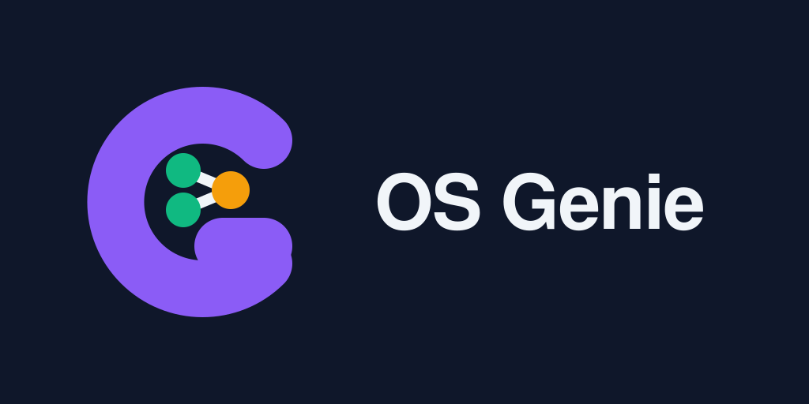

<p align="center">
  
</p>

<p align="center">
  <a href="LICENSE"></a>
  
  
</p>

# OS Genie

Four portable [Agent Skills](https://agentskills.io) that take you from "where do I contribute?" to merged pull request. Data-backed, polyglot, and strict about the things maintainers actually merge on: small diffs, green CI, quoted approval, and evidence.

```
os-genie-repo-finder  →  os-genie-issue-triage  →  os-genie-fix-pr  →  os-genie-maintainer-comms
   (0) discover            (1) triage               (2) implement          (3) communicate
   repos that              ONE approved             smallest green         doubts, reviews,
   still merge             issue worth fixing       PR, tests+proof       bumps, follow-ups
```

## Install (30 seconds)

```bash
npx skills add manish-9245/os-genie
```

That installs all four skills into your agent (`claude-code`, `cursor`, `opencode`, and 70+ more are detected automatically). Manual options and verification are in [docs/installation.md](docs/installation.md).

## The pipeline

| Stage | Skill | Question it answers | Merge gate |
|---|---|---|---|
| 0. Discover | `os-genie-repo-finder` | Which repos merge first-timer PRs? | Health score ≥ 60 (first-pick ≥ 75), 5 hard-rejects |
| 1. Triage | `os-genie-issue-triage` | Which ONE issue is worth fixing? | Score ≥ 60 with quoted maintainer approval |
| 2. Implement | `os-genie-fix-pr` | What is the smallest green PR a maintainer can merge? | Green CI, <200 lines, YAGNI, tests, evidence, secrets sweep |
| 3. Communicate | `os-genie-maintainer-comms` | What do I say when they reply, or go silent? | Templates A–G, 48h reply SLA, polite bumps |

Each skill chains to the next through `metadata.prev-skill` / `next-skill`. Full walkthrough with a worked example: [docs/pipeline.md](docs/pipeline.md).

## Quick demo

```bash
# 1. Pick the issue (example: acme/widgets#412)
gh issue view 412 --repo acme/widgets \
  --json number,title,labels,assignees,comments,createdAt,updatedAt,body,state,milestone > issue.json
python3 skills/os-genie-issue-triage/scripts/score_issue.py issue.json
# → {"score": 100, "verdict": "RECOMMEND", ...}

# 2. Fix, then run the pre-PR gate
bash skills/os-genie-fix-pr/scripts/verify_pr.sh
gh pr create --title "fix(scope): specific description" \
  --body-file skills/os-genie-fix-pr/templates/pull-request.md
gh pr checks --watch
```

## Why the numbers work

Every threshold is traceable to data, not taste. The short version:

- **PR size drives velocity** (LinearB 2025, 6.1M PRs): ~50 lines ideal, <200 good, 400+ likely to miss issues. Hence the <200-line rule and YAGNI razor test.
- **Green CI drives merges** (MSR 2026, ~933k agentic PRs): each failed check cuts merge odds ~15%; CI failure is rejection pattern #1. Hence never-request-review-on-red.
- **Maintainer approval drives scope correctness**: incorrect-implementation rejections cluster where scope was never confirmed. Hence 35 of 100 triage points require quoted approval.
- **Repo health drives follow-through** (gh-analyzer weights, LFX, CHAOSS, CSI validation): momentum 30, bus factor 25, issue health 20, PR latency 15, release loop 10.

Full citations: [docs/methodology.md](docs/methodology.md) and each skill's `references/evidence.md`.

## Requirements

- `gh` authenticated (`gh auth login`) for live queries. Both scorers also run offline on saved JSON.
- `python3` (scorers, stdlib only), `bash` + `git` (pre-PR gate). Node 18+ only for `npx` install.

## Layout

```
skills/
  os-genie-repo-finder/       SKILL.md, references/, scripts/score_repo.py
  os-genie-issue-triage/      SKILL.md, references/, scripts/score_issue.py
  os-genie-fix-pr/            SKILL.md, references/, templates/, scripts/verify_pr.sh
  os-genie-maintainer-comms/  SKILL.md, references/
assets/                       logo.svg, icon.svg, PNG families (16–2048)
logos/                        concepts, preview.html, favicon size check
docs/                         installation, pipeline, methodology
```

## Contributing

PRs welcome. House rules (enforced in review, mirroring what the skills preach):

1. Conventional Commits, imperative mood, subject ≤72 chars (see `skills/os-genie-fix-pr/references/commit-guide.md`).
2. One concern per PR, diffs under 200 lines where possible.
3. No em dash character (U+2014) anywhere in the repo. Use commas or colons.
4. Validate touched skills (`npx -y skills-ref validate ./skills/<name>`) and keep scorers green on the worked examples in [docs/pipeline.md](docs/pipeline.md).

## License

MIT. See [LICENSE](LICENSE). Individual skills also carry `license: MIT` in frontmatter.
